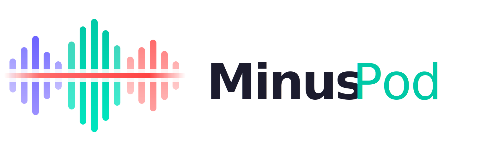
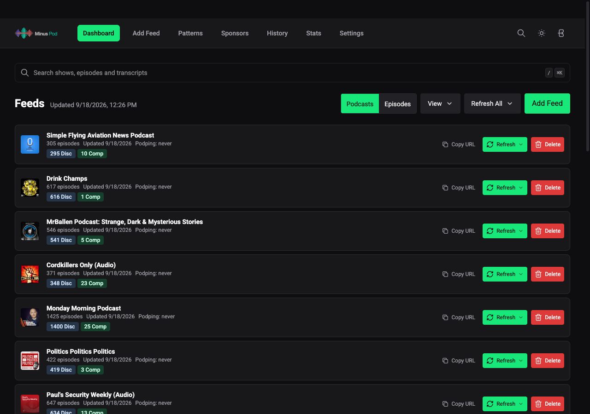
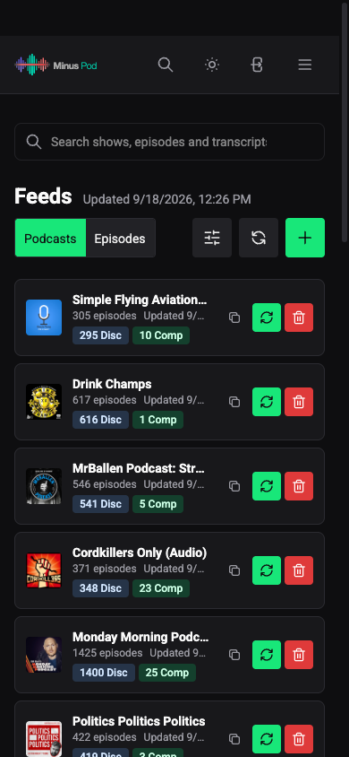

<p align="center">
  
</p>

MinusPod is a self-hosted server that removes ads from podcasts before you ever hit play. It transcribes episodes locally with faster-whisper or Parakeet (or through a remote API), uses an LLM to detect and cut ad segments, and builds cross-episode ad patterns from your corrections so repeat sponsors get caught without re-asking the LLM. Bring your own LLM: Claude, Ollama, OpenRouter, OpenAI-compatible providers, or System One.

<p align="center">
  
  &nbsp;
  
</p>

A tour of the web UI. More videos, portrait cuts and the files themselves in [docs/videos](docs/videos/README.md).

https://github.com/user-attachments/assets/26e4f083-a398-44b4-ad22-e6f753e03f52

## Features

**Ad detection**
- An LLM finds ads in the transcript, a second pass verifies the cut, and an optional reviewer confirms or adjusts each boundary. [How it works](docs/how-it-works.md)
- Audio evidence backs the transcript: loudness and DAI transitions, a cross-fetch diff against a second download, per-feed jingle cues, and the publisher's own transcript. [Audio cues](docs/audio-cues.md), [Transcript differential](docs/transcript-differential.md)
- Each detection gets a category (sponsor, cross-promo, self-promo, intro/outro) and a per-feed action: remove, beep, keep, or mark as a skippable chapter
- Low-confidence cuts wait in a review queue with a waveform editor; your corrections become cross-episode patterns so repeat sponsors are caught without another LLM call
- Five per-feed [processing modes](docs/workflows.md), from full detection to pass-through

**Transcription and LLMs**
- Transcribe locally with faster-whisper or NVIDIA Parakeet on GPU or CPU, or remotely through whisper.cpp, Groq, OpenAI, or OpenVINO. [Transcription](docs/transcription.md)
- Anthropic, OpenRouter, Ollama, System One, or any OpenAI-compatible endpoint, switchable at runtime with per-stage models and editable prompts. [LLM providers](docs/llm-providers.md)
- A/B routing between two providers, [failover](docs/failover.md) to a standby, rate-limit holds, and an offline queue for self-hosted endpoints

**Patterns and sponsors**
- Learned patterns scoped per podcast, network, or globally, with a sponsor list and aliases
- Opt-in [community pattern](patterns/README.md) sync with one-PR contribution back
- Scheduled [Pattern Cleanup](docs/pattern-cleanup.md) suggests trims, splits, and retirements, with approval and undo

**Publishing**
- Re-cut RSS feeds per podcast with versioned audio, a replacement sound at each cut, loudness leveling, and lossless MP3 stream copy where the cut allows
- [Podcasting 2.0](docs/podcasting-2.0.md) tags regenerated: transcripts, chapters, AI-content disclosure, value-for-value passed through
- Podping listener refreshes a feed seconds after the host announces an episode
- OPML import and export, podcast search from Add feed, an optional cover-art badge, a combined Recents feed, and [local feeds](docs/local-feeds.md) built from your own audio files

**YouTube**
- Turn a YouTube playlist or channel into a podcast feed: audio through yt-dlp, the video's captions as the transcript, chapters, artwork and descriptions. [YouTube feeds](docs/youtube-feeds.md)
- Community [SponsorBlock](https://sponsor.ajay.app/) marks are cut as given and learned as patterns. The LLM steps in only when a video has no marks, or on top of them per feed. Off by default.

**Web UI and administration**
- Feed, episode, queue, search, pattern, sponsor, history, stats, and settings views. Installs as an app on iOS, Android, macOS, and Windows. [Web interface](docs/web-interface.md)
- Stats and an LLM cost ledger down to the individual call
- Retention per feed, scheduled encrypted backups, email and webhook notifications, and a REST API with OpenAPI. [API and webhooks](docs/api-and-webhooks.md)
- Password auth for the UI and API, feed keys or per-feed subscriber keys for RSS, provider keys encrypted at rest. [Security](docs/security-and-storage.md)

## How it works

The transcriber turns the episode into text, an LLM marks the ad segments, FFmpeg cuts them, and Flask serves the modified feed and audio. One episode, end to end:

https://github.com/user-attachments/assets/d2f2ad13-71b9-4712-a872-de3c8e867a2a

The full pipeline, including the verification pass, sliding windows, pattern learning, and audio analysis, is in [docs/how-it-works.md](docs/how-it-works.md).

## Requirements

- Docker on an amd64 or arm64 host. An NVIDIA GPU speeds up local transcription but is not required.
- An LLM: an Anthropic or [OpenRouter](https://openrouter.ai) API key, [Ollama](https://ollama.com) for local inference, a System One credential, or any OpenAI-compatible endpoint.

Whisper and Parakeet sizing and RAM/VRAM figures are in [Installation](docs/installation.md#memory-requirements).

## Quick start

```bash
# 1. Create environment file
cat > .env << EOF
ANTHROPIC_API_KEY=your-key-here
BASE_URL=http://localhost:8000
MINUSPOD_MASTER_PASSPHRASE=long-random-string-you-will-not-lose
OPENAI_MODEL=claude-haiku-4-5
EOF

# 2. Create data directory
mkdir -p data

# 3. Run (pick one)
docker compose up -d                              # NVIDIA GPU image
docker compose -f docker-compose.cpu.yml up -d    # CPU image, no GPU needed
```

Open `http://localhost:8000/ui/`, set an application password, and add a feed. The GPU image is amd64 with the NVIDIA container runtime; the CPU image runs natively on amd64 and arm64. Both read the same `.env` and `data/` directory.

`MINUSPOD_MASTER_PASSPHRASE` encrypts provider keys at rest, so set it before you store any. Remote first-time setup, public processing, and the slower `stable` release channel are covered in [Installation](docs/installation.md#quick-start).

## Documentation

| Topic | |
|---|---|
| [Installation](docs/installation.md) | Requirements, sizing, quick start, CPU image |
| [Environment variables](docs/environment-variables.md) | Every env var |
| [LLM providers](docs/llm-providers.md) | Providers, recommended models, pricing |
| [Transcription](docs/transcription.md) | faster-whisper, Parakeet, remote APIs, [OpenVINO](docs/transcription-openvino.md) |
| [Web interface](docs/web-interface.md) | Management UI and the ad editor |
| [How it works](docs/how-it-works.md) | The detection pipeline in depth |
| [Workflows](docs/workflows.md) | Processing modes, re-runs, failure paths |
| [Configuration](docs/configuration.md) | Every setting and experiment |
| [Security and storage](docs/security-and-storage.md) | Remote access, authenticated feeds, backups |
| [API and webhooks](docs/api-and-webhooks.md) | REST endpoints, webhook events, notifications |
| [Podcasting 2.0](docs/podcasting-2.0.md) | What is emitted, regenerated, and stripped |
| [Glossary](docs/glossary.md) | Every term the app uses |

The [full docs index](docs/README.md) covers the rest: audio cues, community patterns, Pattern Cleanup, System One, failover, local feeds, YouTube feeds, download history, configuration import and export, deployment, releasing, and the [LLM benchmark report](benchmarks/llm/results/report.md).

## Contributing

Bug reports, feature requests, and pull requests are welcome. Open an issue first for larger changes so we can agree on the approach. Ad patterns go through [Community Patterns](patterns/README.md) and benchmark results through [Benchmark Contributing](benchmarks/llm/CONTRIBUTING.md). Fork-derived features and community bug reports are credited in the CHANGELOG entry that ships them.

## Disclaimer

This tool is for personal use only. Only use it with podcasts you have permission to modify or where such modification is permitted under applicable laws. Respect content creators and their terms of service.

YouTube feeds download audio with yt-dlp. That can conflict with YouTube's terms of service; the feature is off by default and is yours to enable.

## License

MIT

## LLM disclosure

This project was developed using AI agents as a pair programmer. It was NOT vibe coded. For context, I'm a systems engineer who also writes code professionally with 15+ years of experience. The codebase follows engineering best practices, and all architecture and design decisions were made by me, not by AI. All code generated by LLMs was reviewed and tested by me, a human.
