# UI audit completion pass

Date: 2026-10-16. Follow-up to commit `54d1356a538314ee1d2e03eaafea0a59c1a0a0ed` in [PR 862](https://github.com/ttlequals0/MinusPod/pull/862).

The remaining code repairs are implemented. Local Chromium, WebKit, save, audio, recut, cancellation, cue-scan, and service-worker update checks passed. Physical iOS and VoiceOver remain unverified, as requested when no device was available.

[Before/after comparisons and active status-bar images](completion-gallery.html) show the actual application. The before images show the previous PR revision; the after images show this completion pass.

## Repairs

| Item | Root cause | Change |
| --- | --- | --- |
| UI-12: field associations | Visible text was not always connected to its input; numeric wrappers could not forward descriptions. | Associate Sponsor labels, Add Feed validation, settings help, notification/password errors, and ad-boundary errors. Numeric and tri-state controls forward descriptions. Use the existing field styles for Sponsor inputs. |
| UI-09: independent drafts | The page-level save guard did not cover section-owned state. | Register keys, notification forms, webhook editing, backups, community sync, Podping, pricing, queue settings, cleanup, timeouts, retention, tunables, configuration import, local-feed metadata, and shared draft fields. Closing a webhook or upload editor requires an explicit discard. |
| UI-09: refresh and failed-save loss | Notification and local metadata forms reseeded on refresh. Retention cleared its draft before the server accepted it. | Preserve dirty values during refresh. Clear retention only after success. Disable notification, key, pricing, password, and local-metadata inputs while their save owns the submitted values. |
| UI-17: headers and cards | Pages copied their own header and card classes. | Share title, description, responsive header, Counter, and Metric typography. Apply the same Stats card component to averages and totals. Preserve aligned History values and labels. |
| UI-02: WebKit focus restoration | WebKit did not focus clicked trigger buttons, so remembering only `activeElement` lost the return target. | Capture activation in the root shell and restore that trigger when the dialog closes. Nested dialogs retain their existing focus ownership. |
| UI-08: webhook deletion | A webhook still used a timed second-click confirmation. | Use the shared explicit confirmation dialog and retain a failed deletion for retry. |
| Timezone selection | The browser's timezone list omitted UTC unless UTC was already selected. | Always include UTC, including after another timezone is selected. |
| UI-13: status/update layout | The status inset started inside Layout, below the update notice; mobile-menu height used a fixed allowance. | Reserve the measured inset before the update notice and page shell. Calculate mobile-menu height from the same inset. |

The [behavior contract](../../../design-guide/UI-CONTRACT.md) now states these field, draft, header, summary, focus, and inset rules. The HTML guide's Counter and Metric examples match the implementation. CI includes WebKit and accessible-form checks.

## Verification

| Check | Result | Evidence |
| --- | --- | --- |
| Frontend unit suite | 148 test files; 1,828 tests passed | [Validation log summary](validation.txt) |
| Browser contracts | 72 checks passed: 9 checks x 4 widths x 2 engines; widths 320, 390, 768, and 1440 CSS px | [Browser suite](../../../frontend/e2e/ui-contract.spec.ts) |
| Independent drafts and saves | 44 checks passed across Chromium/WebKit at 390 and 1440 CSS px. Cancelled navigation preserved edits; timezone saves persisted; a real rejected retention save retained the value and error. | [Save evidence](completion-save-evidence.json), [repeatable checks](verify-live.cjs) |
| Accessible forms | No axe WCAG A/AA findings in the 8 scanned route states at 390 CSS px, including expanded Settings and the Sponsor dialog | [Accessibility evidence](completion-accessibility-evidence.json) |
| History alignment | Value and label starts still align at 320, 390, 640, 768, 1024, and 1440 CSS px | [Alignment evidence](completion-history-evidence.json) |
| Audio and waveform | Original-episode playback and waveform peaks passed in Chromium and WebKit; byte-range requests returned HTTP 206 with 1,024 bytes. | [Media evidence](completion-media-evidence.json) |
| Editor save and recut | A real correction saved; recutting completed and the new processed audio supported byte-range requests. | [Media evidence](completion-media-evidence.json), [recut evidence](completion-recut-evidence.json) |
| Active cancellation | WebKit cancelled a running recut from Queue; the active job disappeared | [Cancellation evidence](completion-cancellation-evidence.json) |
| Cue scan | The uploaded real cue clip completed scanning with an empty result; no error or indefinite loading state | [Cue evidence](completion-cue-evidence.json) |
| PWA update | Chromium and WebKit installed an actual service worker, detected a different production build, blocked reload while a timezone draft was dirty, then loaded the new build after Save and explicit Reload. The saved value survived. | [Update evidence](completion-pwa-evidence.json) |
| Theme coverage | Existing tests for all 20 themes in light/dark modes passed with the full unit suite. The changes use shared theme tokens. | [Original contrast evidence](contrast-after.json), [validation](validation.txt) |

Automated accessibility checks cover the rendered states above. They do not establish complete screen-reader usability or WCAG conformance.

## Visual comparisons

These are actual frontend captures. The before column is PR revision `54d1356a`; the after column contains this pass. The [gallery](completion-gallery.html) provides full-size images and device filters.

| Page and viewport | Before | After |
| --- | --- | --- |
| Settings, 390 CSS px | 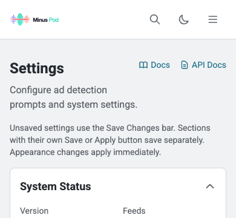 | 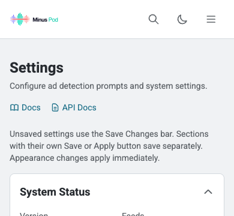 |
| Settings, 1440 CSS px | 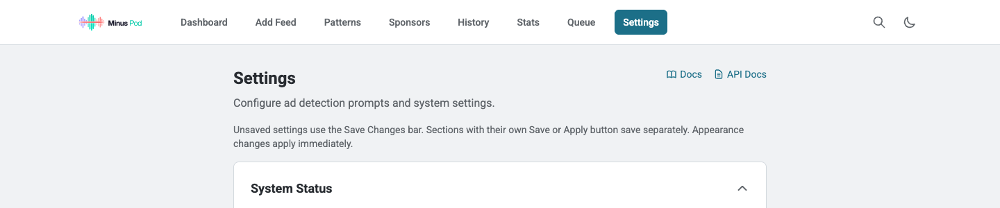 | 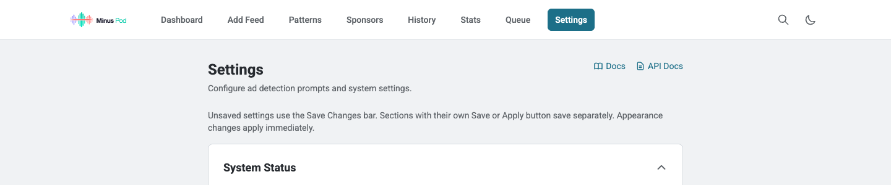 |
| Sponsors, 390 CSS px |  | 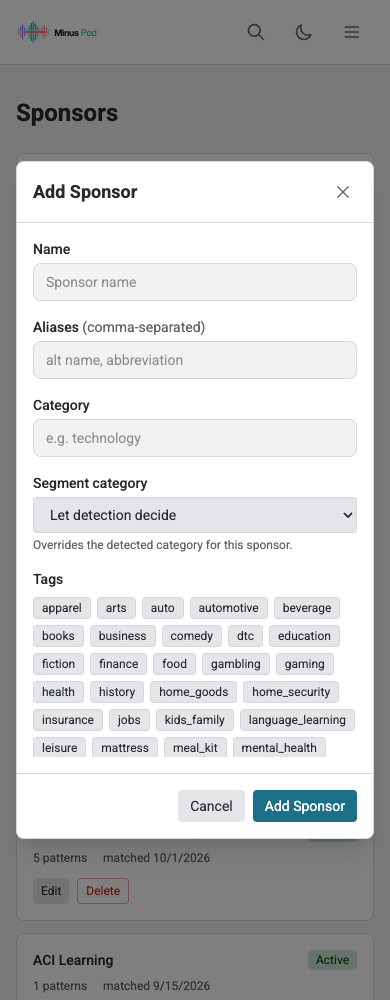 |
| Sponsors, 1440 CSS px | 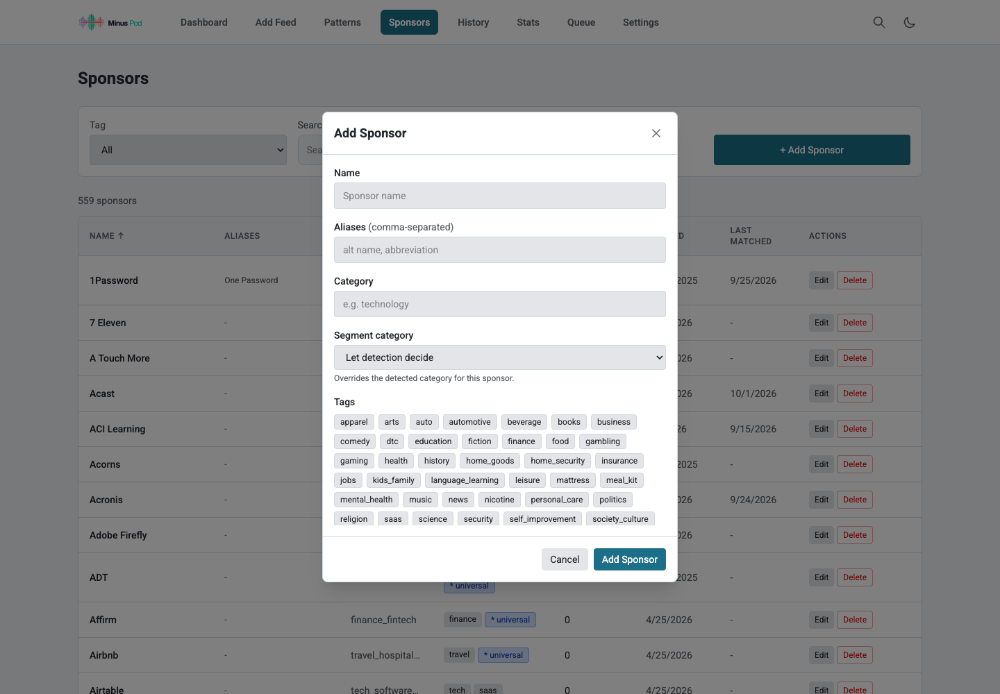 |  |
| Stats, 390 CSS px | 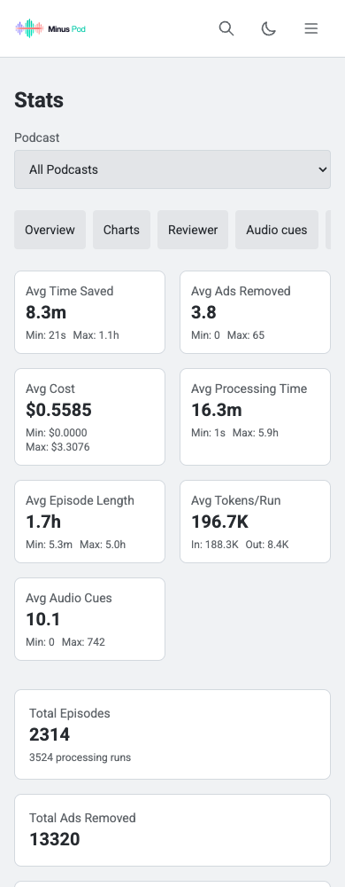 | 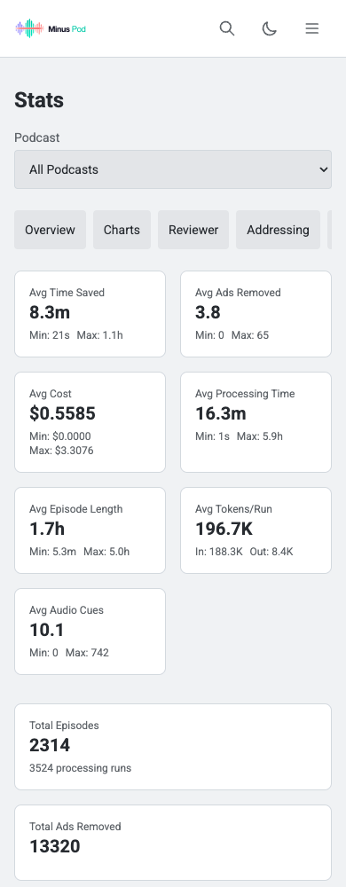 |
| Stats, 1440 CSS px | 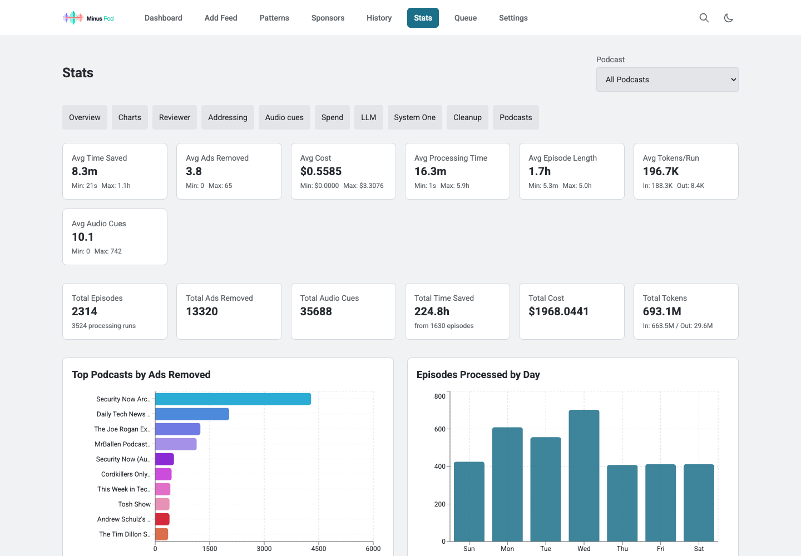 | 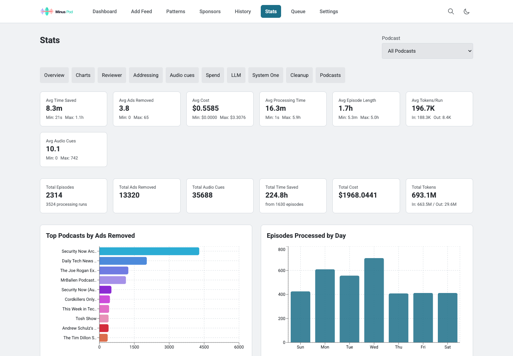 |

## Status-bar behavior

During the actual recut, the header started at 45 CSS px with the status bar collapsed and 164 CSS px with it expanded. At both 390 and 1440 CSS px viewport widths, the header top matched the bar bottom. After processing finished, the header returned to 0 CSS px. The bar moves the interface down dynamically; it does not cover the navigation in these checks.

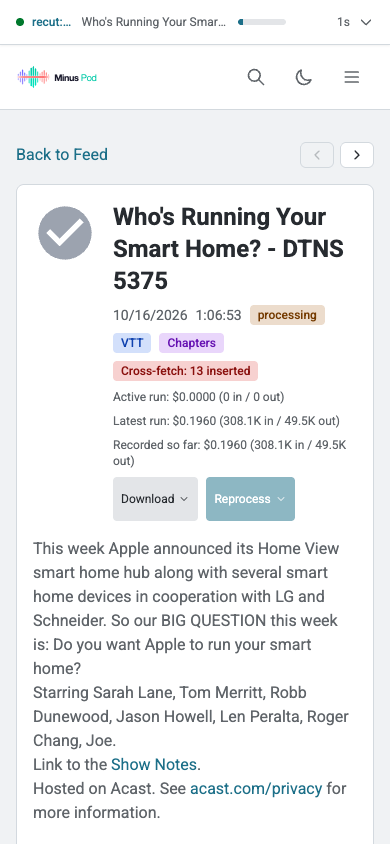

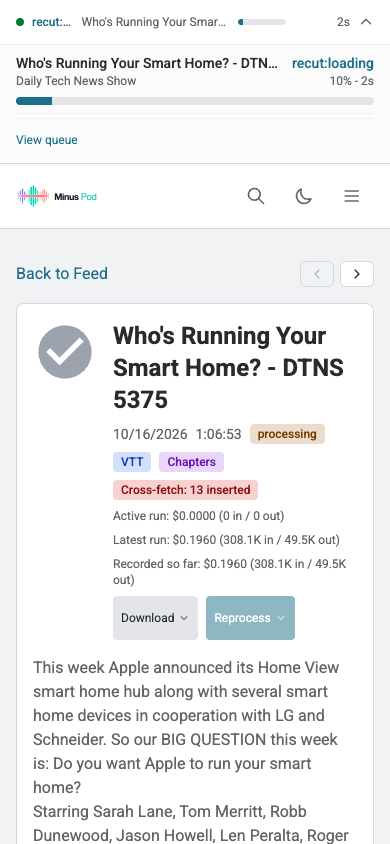

## Test data and limits

All mutations ran against a separate disposable copy of the supplied backup. Periodic background tasks and external connections stayed disabled. Explicit local jobs were enabled only for the recut/cancellation checks. No provider call or notification was sent. The original backup was not changed.

The upload used the repository's real `wsj_content_transition.flac`, converted to MP3. The recut used the DTNS episode's real CDN enclosure, downloaded separately because the backup contains no media. Its fetched duration was 3,950.888375 seconds; the backup records 4,013.296327 seconds. This verifies playback, editor persistence, rendering, and job controls. It does not verify that old ad boundaries match a newly served CDN edition. The media stays outside Git.

The following checks remain **unverified**, with no substitute claimed:

- Physical iPhone/iPad Safari: keyboard behavior, actual safe-area insets, rotation, and touch interactions.
- VoiceOver: announcements, reading order, rotor navigation, and dialog use on a real device.
- An installed iOS home-screen PWA receiving an update. Browser service-worker updates passed in both engines; installed-device behavior was not tested.

The separate documentation review still records Parakeet runtime peak-memory benchmarking as unavailable. This completion pass does not add an unmeasured sizing claim.

## Repeating the save checks

Use two disposable database copies named `podcast.db`. Never point either launcher at the source backup or production data.

```sh
# Read-only instance; default port 8000.
MINUSPOD_AUDIT_DATA=/path/to/read-only-copy \
  python3 docs/audits/ui-ux-2026-10-16/serve-backup.py

# Separate writable instance; periodic jobs and external sockets stay disabled.
MINUSPOD_AUDIT_DATA=/path/to/writable-copy MINUSPOD_AUDIT_PORT=8001 \
  MINUSPOD_AUDIT_WRITABLE=1 \
  python3 docs/audits/ui-ux-2026-10-16/serve-backup.py
```

Point separate Vite servers at those backends with `VITE_PROXY_TARGET`. Run from `frontend`:

```sh
MINUSPOD_LIVE_URL=http://127.0.0.1:5175/ui \
MINUSPOD_READONLY_URL=http://127.0.0.1:5173/ui \
  node ../docs/audits/ui-ux-2026-10-16/verify-live.cjs
```

These populated checks target the supplied backup's enabled sections. The optional `MINUSPOD_AUDIT_RUN_JOBS=1` flag allows explicit processing only when writable mode is also enabled. Leave it unset for the save checks.
