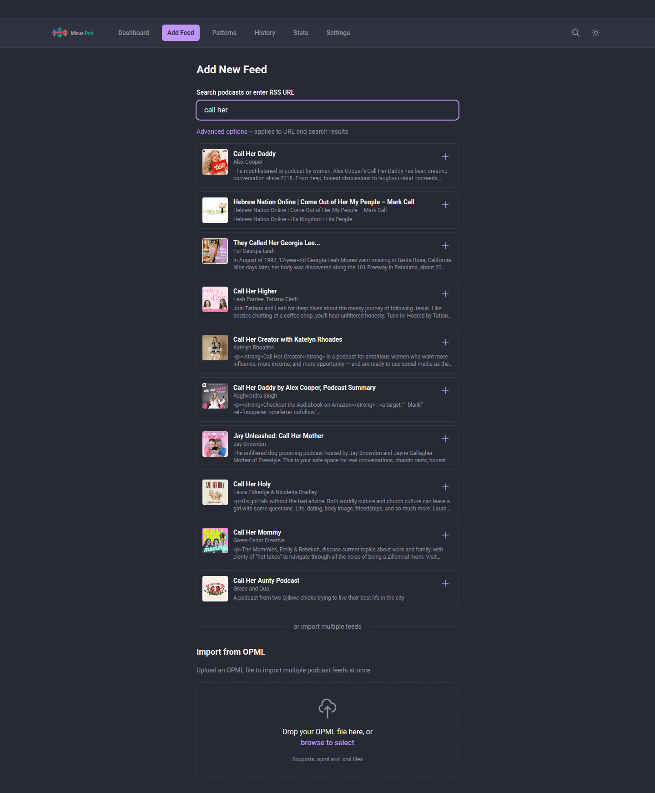

# Finding Feeds & Usage

[< Docs index](README.md) | [Project README](../README.md)

---

Adding a podcast on a phone and playing it in a podcast app without its ads, start to finish. Portrait cut and the file itself in [Videos](videos/README.md).

https://github.com/user-attachments/assets/8a997cba-20a1-40aa-b437-058d57306f45

## Finding Podcast RSS Feeds

MinusPod includes a built-in podcast search on the Add Feed page. It works out of the box using Apple's iTunes directory, which needs no account or API key. If you prefer [PodcastIndex.org](https://podcastindex.org), pick it under Settings > Podcast Search, get free API credentials at [api.podcastindex.org/signup](https://api.podcastindex.org/signup), and add them there; the **Test connection** button sends a signed one-result search so you know the credentials work before you need them. Installs that already had PodcastIndex credentials before the provider option existed keep using PodcastIndex until they choose otherwise.



You can also find RSS feeds manually:

1. **Podcast website** - Look for "RSS" link in footer or subscription options
2. **Apple Podcasts** - Search on [podcastindex.org](https://podcastindex.org) using the Apple Podcasts URL
3. **Spotify-exclusive** - Not available (Spotify doesn't expose RSS feeds)
4. **Hosting platforms** - Common patterns:
   - Libsyn: `https://showname.libsyn.com/rss`
   - Spreaker: `https://www.spreaker.com/show/{id}/episodes/feed`
   - Omny: Check page source for `omnycontent.com` URLs

### No RSS feed at all

If a show never had an RSS feed to begin with, such as your own recordings or an archive of downloaded episodes, see [Local Feeds](local-feeds.md) for building a feed from your own audio files instead of finding one to subscribe to. For a show that only exists on YouTube, see [YouTube Feeds](youtube-feeds.md).

## Usage

Add your modified feed URL to any podcast app:
```
http://your-server:8000/your-feed-slug
```

The feed URL is shown in the web UI and can be copied to clipboard.

### Audiobookshelf

If using [Audiobookshelf](https://www.audiobookshelf.org/) as your podcast client, its SSRF protection will block requests to MinusPod when running on a local/private network. Add your MinusPod hostname or IP to Audiobookshelf's whitelist:

```
SSRF_REQUEST_FILTER_WHITELIST=minuspod.local,192.168.1.100
```

This is a comma-separated list of domains excluded from Audiobookshelf's SSRF filter. See [Audiobookshelf Security docs](https://www.audiobookshelf.org/docs/#security) for details.

### Feeds on a private or LAN host

MinusPod validates feed source URLs and blocks private/loopback/LAN addresses by default (SSRF protection). If a feed source is on a private address (a LAN Audiobookshelf server or a self-hosted feed), you have two options:

- Recommended: list only the hosts you need in `MINUSPOD_PRIVATE_FEED_HOSTS`, a comma-separated mix of hostnames, IP addresses and CIDR ranges, for example `MINUSPOD_PRIVATE_FEED_HOSTS=nas.lan,192.168.1.0/24`. A hostname entry allows that exact name (case-insensitive) on any private address. An IP or CIDR entry allows any hostname that resolves entirely inside the range. Loopback, link-local, unspecified and cloud metadata addresses are allowed only by an exact single-address entry (a bare IP, `/32` or `/128`): never by a hostname, and never by a wider range such as `127.0.0.0/8`, `169.254.0.0/16` or `fd00::/8`. Other private hosts stay blocked.
- Ports: feed URLs must use port 80, 443, 8080 or 8443, otherwise the add fails with "Blocked port". To use another port on a listed host, add it to the entry as `host:port`, for example `MINUSPOD_PRIVATE_FEED_HOSTS=nas.lan:8000,192.168.1.7:3000,[fd00::5]:3000`. The entry also allows that host on the default ports, opens only that exact port, and applies to a hostname or a single IP, not a CIDR range. `MINUSPOD_ALLOW_PRIVATE_FEED_HOSTS=true` skips the port check.
- All or nothing: `MINUSPOD_ALLOW_PRIVATE_FEED_HOSTS=true` allows every private feed source address.

Both apply to feed source URLs only (adding, editing, importing and refreshing a feed, and redirects from them). Episode audio and artwork URLs found inside a feed stay on the strict check. Neither can be changed from the UI.

## Served feeds are marked private

Pocket Casts matches an added feed to a public listing when the Title,
Author, Website URL and Thumbnail URL match, then shows the public show's
metadata instead of yours. The documented fix is `<itunes:block>Yes</itunes:block>`
in the feed. MinusPod adds that tag to every feed it serves and replaces any
upstream `itunes:block` value, so directories skip the feed and Pocket Casts
stops matching it. Apple Podcasts and Overcast treat the feed as private but
still accept it when added by URL.

Turn it off with **Mark served feeds private** in Settings
(`feedItunesBlock`, on by default). The upstream value then passes through
unchanged. Pocket Casts keeps a match it already made, so remove a matched
feed and add it again.

Pocket Casts fetches feeds from its own servers and keeps what it fetched for a
feed URL. If you first added a URL while it returned the wrong content (a wrong
address, the private tag off, or ads not yet removed), removing and re-adding
the same URL can keep showing the old copy. Users report that adding the feed
again under a URL Pocket Casts has not seen fixes it. Append a query string such
as `?fresh=1`, or `&fresh=1` after an existing `?key=`. MinusPod ignores unknown
query parameters and serves the same feed.

## LLM Cost and Model-Usage Stats API

Two read-only endpoints expose the LLM call ledger for cost tracking: `GET /api/v1/stats/model-usage` breaks down spend by provider and model, and `GET /api/v1/stats/episode-costs` breaks it down by episode instead. Both are paginated (`page`, `limit`), sortable (`sortBy`, `sortDir`), and filterable by date range (`from`, `to`), `podcastSlug`, `provider`, and `model`.

Spend includes failed calls that were still billed by the provider, not just successful ones. A model's cost can be `unknown` if MinusPod has no pricing data for it; `model-usage` reports these separately as `unknownCostCount` rather than folding them into the total as zero. `episode-costs` distinguishes an episode's most recent processing run (`latestRunCostUsd`) from its lifetime total across every run (`cumulativeCostUsd`), which differ once an episode has been reprocessed.

See `openapi.yaml` for full parameter and response details.

---

[< Docs index](README.md) | [Project README](../README.md)
