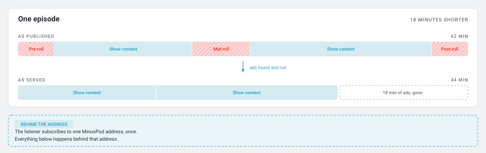
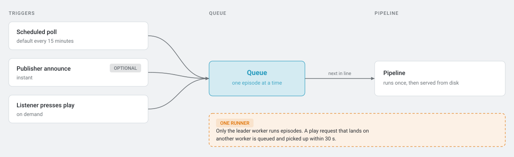
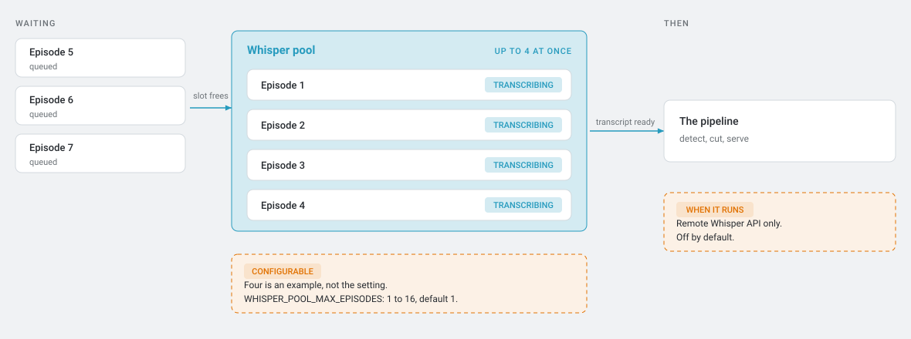
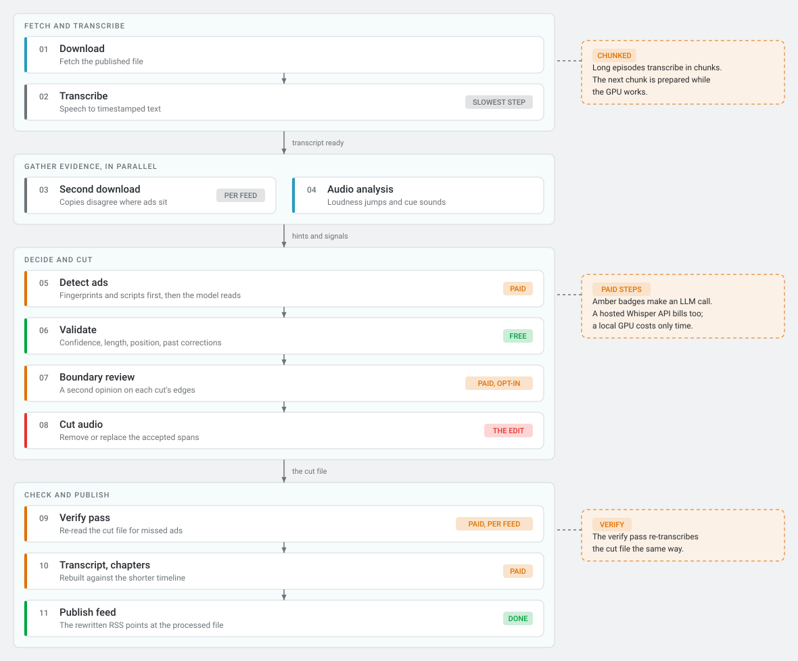
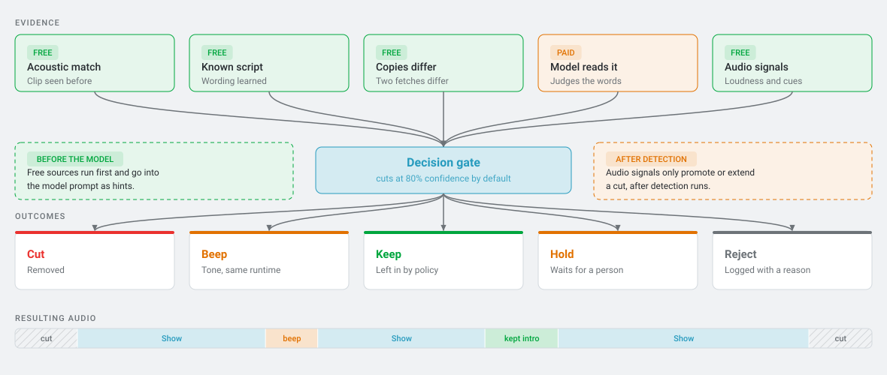
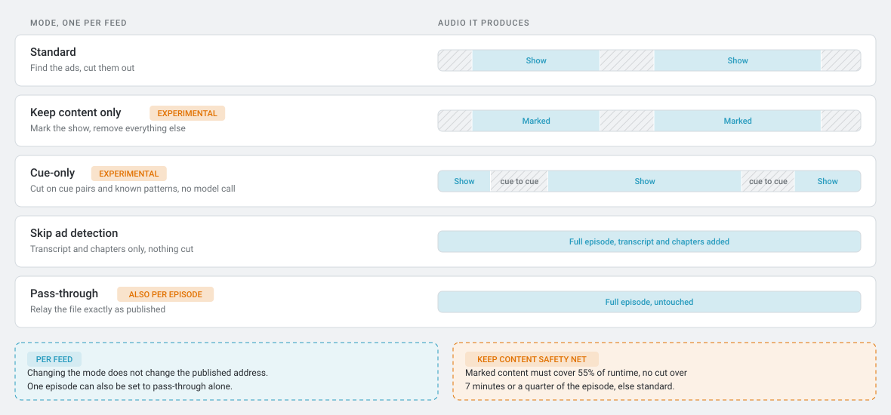
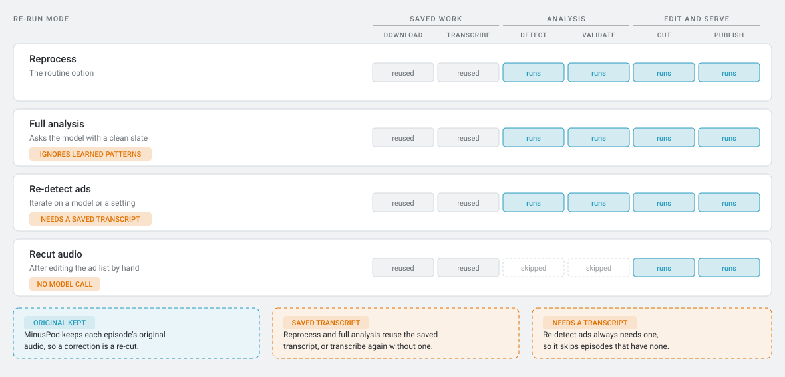
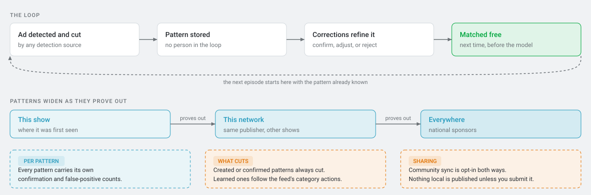
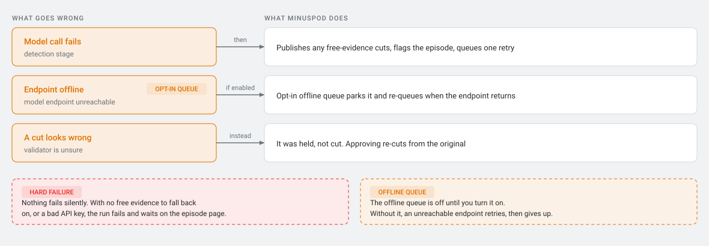

# Episode Processing Workflows

[< Docs index](README.md) | [Project README](../README.md)

Every way MinusPod can process an episode, in pictures. For the behaviour
behind each stage, see [How It Works](how-it-works.md).

---

## Contents

- [The job](#the-job)
- [How work arrives](#how-work-arrives)
- [The Whisper pool](#the-whisper-pool)
- [The standard pipeline](#the-standard-pipeline)
- [The YouTube pipeline](#the-youtube-pipeline)
- [Five kinds of evidence, five outcomes](#five-kinds-of-evidence-five-outcomes)
- [Processing modes](#processing-modes)
- [Re-running an episode](#re-running-an-episode)
- [Learning loop](#learning-loop)
- [When something breaks](#when-something-breaks)

## The job

<picture>
  <source media="(prefers-color-scheme: dark)" srcset="images/wf-overview-dark.svg">
  
</picture>

The listener subscribes to a MinusPod address once. Everything below happens
behind that address.

---

## How work arrives

<picture>
  <source media="(prefers-color-scheme: dark)" srcset="images/wf-arrival-dark.svg">
  
</picture>

---

## The Whisper pool

<picture>
  <source media="(prefers-color-scheme: dark)" srcset="images/wf-pool-dark.svg">
  
</picture>

The four concurrent episodes in the diagram are an example, not the setting.
Concurrency is configurable: `WHISPER_POOL_MAX_EPISODES` accepts 1 to 16 and
defaults to 1, and out-of-range values are clamped rather than rejected. A
separate cap, `WHISPER_POOL_MAX_REQUESTS` (1 to 64, default 4), limits how
many transcription requests are in flight at once.

By default one episode runs at a time. Turn on the Whisper pool and raise its
per-episode limit to transcribe several at once; the rest wait in the queue and
start as slots free. Each running episode still flows through the same pipeline
once its transcript is ready. The pool is off by default.

Whatever the backend, only the background leader worker runs episodes. A
reprocess or play request that lands on another gunicorn worker is queued and
the leader's dispatcher picks it up on its next pass, within 30 s. One process
holds every per-run state and every local transcription model, so two workers
can never load a model each on the same GPU.

The pool only activates on the remote Whisper API backend. Turning it on while
transcription runs locally leaves it inactive, because the local model runs
in-process and several episodes would contend for the same GPU. An inactive
pool reports a per-episode limit of 1 whatever the setting says, so the queue
keeps running one episode at a time.

---

## The standard pipeline

<picture>
  <source media="(prefers-color-scheme: dark)" srcset="images/wf-pipeline-dark.svg">
  
</picture>

Amber badges mark the stages that make an LLM call. Transcription is billed too
if you point it at a hosted Whisper API; on a local GPU it costs only time.

Long episodes transcribe in chunks sized to fit GPU memory. Cutting and
normalizing a chunk is its own ffmpeg pass, and that pass runs ahead of the
GPU: while one chunk transcribes, the next ones are already being prepared.
The verify pass re-transcribes the cut file the same way.

---

## The YouTube pipeline

A YouTube feed has no upstream RSS, so MinusPod builds the episode list itself and waits for community SponsorBlock marks before it cuts. Detail for every step is in [YouTube Feeds](youtube-feeds.md).

- **Discovery.** On the normal feed refresh schedule MinusPod lists the playlist, channel or single video. It uses the YouTube Data API when a key is set and yt-dlp otherwise. Private and deleted entries are hidden.
- **Serving.** The served feed lists every discovered episode with its upload date. Nothing is processed at discovery: the first play of an unprocessed episode starts processing, and the podcast app is told to retry until the cut is ready.
- **SponsorBlock gate.** An episode waits the processing delay, then MinusPod probes SponsorBlock a set number of times at a fixed interval. The first probe that finds marks queues the episode. If none appear after the last probe, the LLM pipeline runs as a fallback. With the fallback off, the episode enters a watch window and is checked at the watch interval until the watch ceiling.
- **Cutting.** Marks are cut as given, with no LLM call by default. Learned patterns (audio fingerprints and text patterns) always run, and MinusPod learns new patterns from the marks it cuts. Pass 1 detection, a per-feed switch, adds the LLM on top and cuts both sets of segments. If the marks change during the watch window, the episode is recut from the retained original.
- **Transcript.** When captions exist and the captions setting is on, they become the transcript and Whisper is skipped. Creator chapters are reused, so the chapter generation call is skipped too.
- **Metadata backfill.** A background pass fills missing descriptions and exact publish times from each video's metadata, for up to 10 episodes per refresh pass, without downloading.

Global settings live in Settings > YouTube. The delay, probe, fallback, captions, private-video hiding, transcription fallback and Shorts settings can be overridden per feed, while the watch interval and ceiling are global only. See [Configuration](configuration.md#youtube) for the full table.

---

## Five kinds of evidence, five outcomes

<picture>
  <source media="(prefers-color-scheme: dark)" srcset="images/wf-detection-dark.svg">
  
</picture>

Four of the five cost nothing. Fingerprints, learned scripts and the two-copy
comparison are gathered before the model reads the transcript, and go into its
prompt as hints. Audio signals are measured then too, but only promote or extend
a cut after detection runs. Whatever a source proposes still has to clear the
gate.

---

## Processing modes

One mode per feed. Changing it does not change the published address. A single
episode can also be set to pass-through on its own, which overrides the feed
mode for that episode only: it skips transcription, detection, and editing.
The audio may still be transcoded for serving, so pass-through means no ad
removal rather than byte-identical audio. Set it from the episode page's Reprocess menu, or
select episodes on the feed page and use the bulk pass-through action.

<picture>
  <source media="(prefers-color-scheme: dark)" srcset="images/wf-modes-dark.svg">
  
</picture>

| Stage | Standard | Keep content | Cue-only | Skip detection | Pass-through |
|---|:-:|:-:|:-:|:-:|:-:|
| Transcribe | yes | yes | optional | yes | no |
| Second download | per feed | per feed | per feed | no | no |
| Audio analysis | yes | yes | yes | no | no |
| Model reads transcript | yes | inverted | no | no | no |
| Learned patterns | match, learn | match only | match, learn | no | no |
| Verify pass | per feed | per feed | no | no | no |
| Audio edited | yes | yes | yes | no | no |
| Transcript, chapters | yes | yes | optional | yes | no |

**Keep content safety net.** Marked content has to cover at least 55% of the
runtime, no single cut may exceed 7 minutes or a quarter of the episode, and
every transcript window has to come back labelled. Miss any of those and the
episode falls back to standard detection on its own.

One episode under each of the five modes, then segment categories and the remove, beep, keep and mark actions. Portrait cut and the file itself in [Videos](videos/README.md).

https://github.com/user-attachments/assets/436ca512-fb37-4f38-a0eb-6d9b8954457d

---

## Re-running an episode

<picture>
  <source media="(prefers-color-scheme: dark)" srcset="images/wf-rerun-dark.svg">
  
</picture>

Reprocess and full analysis reuse the saved transcript when there is one, and
transcribe again when there is not. Re-detect ads always needs one, so it skips
episodes that have none.

---

## Learning loop

<picture>
  <source media="(prefers-color-scheme: dark)" srcset="images/wf-learning-dark.svg">
  
</picture>

Every pattern carries its own confirmation and false-positive counts. One you
created or confirmed always cuts what it matches; one the system learned on its
own still answers to the category actions set for the feed.

Community sync is opt-in in both directions. Nothing local is published unless
you submit it.

---

## When something breaks

<picture>
  <source media="(prefers-color-scheme: dark)" srcset="images/wf-failure-dark.svg">
  
</picture>

Nothing fails silently. A run with no free evidence to fall back on, or one that
died on a bad API key, fails outright and waits for you on the episode page. The
offline queue is off until you turn it on; without it, an unreachable endpoint
retries and then gives up.

---

Diagrams are generated, not hand-drawn. Edit
[`scripts/generate_workflow_diagrams.py`](../scripts/generate_workflow_diagrams.py)
and re-run it to rebuild `docs/images/wf-*.svg`. Colors come from the
`index.css` tokens, so they track the app's own theme.

[< Docs index](README.md) | [Project README](../README.md)
